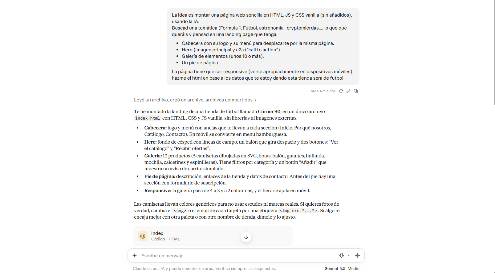
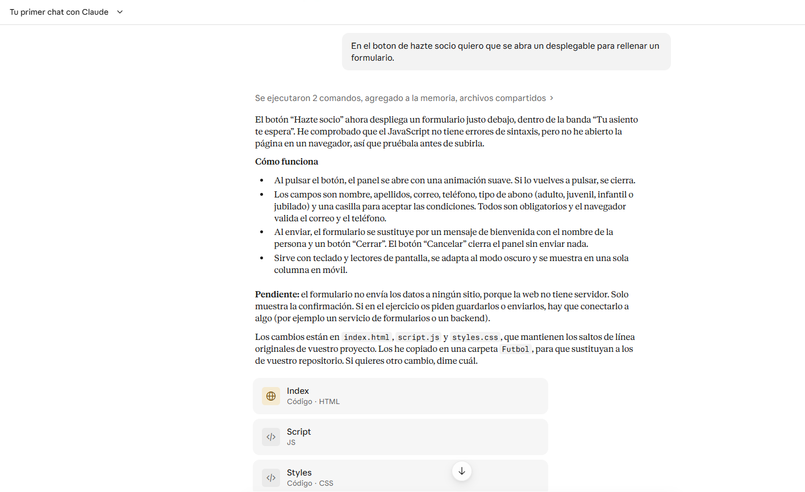

# Futbol
Una página web sencilla en HTML, JS y CSS vanilla (sin añadidos), usando la IA.

Descripción

Este proyecto consiste en crear un landing mediante vibe coding relacionada con una temática (en nuestro caso el fútbol).

---------------------------------------------------------------

Integrantes del equipo

Nombre y apellidos – Adrián Sánchez Morón (adrianlara2665).

Nombre y apellidos – Francisco Manuel Medina (ErSosio)

Nombre y apellidos – Marcos González (marckgonzdiez-art)

---------------------------------------------------------------

Tareas realizadas

- Distribución de tareas.

- Trabajo mediante ramas.

- Integración de cambios.

- Resolución de conflictos.

---------------------------------------------------------------
Imágenes de los prompt utilizados en nuestro proyecto

